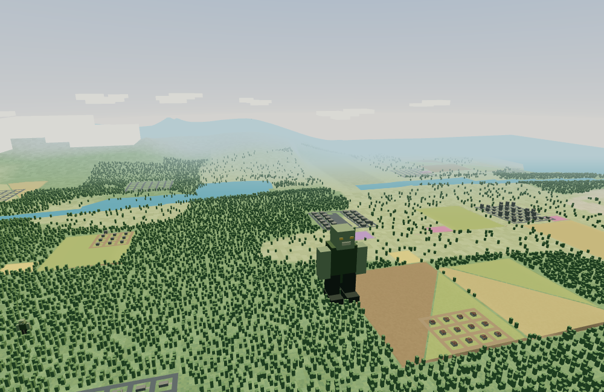
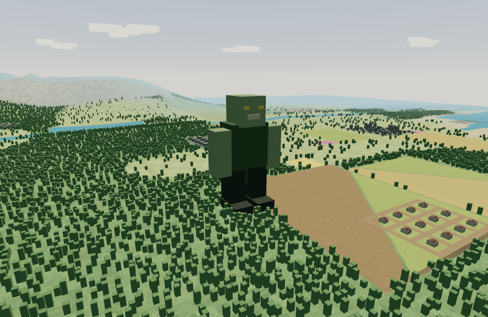

# Micro Voxel World: Frontier

**Take off. Find the fight. Make it home.**

Frontier is an arcade aircraft combat game set in a huge, procedurally generated world. Fly low across connected fields, dirt roads, forests, rivers and mountain ranges. Find roaming zombie hordes and towering mutant bosses, choose your attack, then bring your aircraft home to bank the rewards.

<p align="center">
  
  
</p>

## The sortie

Every run starts on the home runway. Take off and head for a horde, explore a new region, or follow the hangar’s navigation marker toward **Carrier Resolute** and the sparse battleship groups in the ocean. Airfields and carrier decks both support the same landing, reward banking, shopping and takeoff loop.

Hordes are your targets. **Mutant Brutes** and **Colossal Mutants** tower over the terrain and carry large health pools. They never attack the aircraft, but their bodies are solid collision hazards. Choose your weapon, line up a pass and keep clear of the ground.

A kill earns money and XP, but the rewards stay at risk until you land and bring the aircraft to a full stop. A crash loses the unbanked haul. A successful landing opens the hangar, where you can train a pilot skill, buy and equip gear, or launch the next sortie. A carrier you land on becomes your recovery base for the rest of the session; reloading starts you back at home.

## A world worth exploring

The seeded landscape combines plains, forests, connected triangular and rectangular crop parcels, small flower fields, rural dirt tracks, towns, rivers, lakes, ocean and larger mountain ranges. Roads appear ahead of the aircraft as you travel. Sparse naval groups put carriers and battleships out on the water.

The pilot’s skill tree has three branches—Flight, Gunnery and Operations—with 18 skills and three ranks per skill. The equipment shop offers 18 unlocks for engine, weapon, airframe and utility slots. Skill points come from banked XP; cash purchases and loadout changes require a safe landing.

Boss rewards before bonuses:

- **Brute:** 24 m tall, 3,500 HP, $600 and 900 XP.
- **Colossus:** 125 m tall, 24,000 HP, $4,000 and 6,000 XP.

## Controls and landing

- **E / Q:** increase / reduce throttle. Hold Q to idle and brake on a runway or carrier deck.
- **W / S:** pitch down / up. **A / D:** bank and turn.
- **Space:** fire. **1 / 2 / 3:** select a weapon. **C:** toggle camera orbit.
- **Esc:** pause and open the hangar.

To land, line up with the strip, level the wings and touch down below 48 m/s while descending less than 4 m/s. Keep the whole aircraft inside the marked strip, then hold Q until the aircraft stops for one second. The destination selector changes your bearing and marker; it does not teleport the aircraft.

## Run Frontier

Use Node.js 24 and npm:

```sh
npm ci
npm run dev
```

Open [http://localhost:5173/](http://localhost:5173/) to play. Sound starts muted. Pilot progression and world changes save in your browser; reloading starts a new sortie at home.

## Voxel workshop

Open [the voxel workshop](http://localhost:5173/tools/voxel-editor/) directly, or
use the hangar’s **Enable developer tools** option. Inspect and edit voxel sources,
import/export JSON, and export optimized GLB meshes. Workshop edits are held only
for the session; export source JSON to keep them.

See the [workshop and development guide](docs/development.md) for editing controls,
asset references, commands and repository conventions.

## Development

- `npm run build` — typecheck and build Frontier and the workshop.
- `npm run preview` — serve the production build locally.
- `npm run check` — lint, unit tests, asset validation, build and browser checks.
- `npm run combat:benchmark` — run the retained headless crowd/fire benchmark.

Install the test browser once with `npx playwright install chromium`. Run browser
checks against a completed production build.

Historical prototype/lab instructions are kept in [development history](docs/development-history.md).
Benchmark-only legacy code is documented in [tools/benchmarks/legacy](tools/benchmarks/legacy/README.md).
