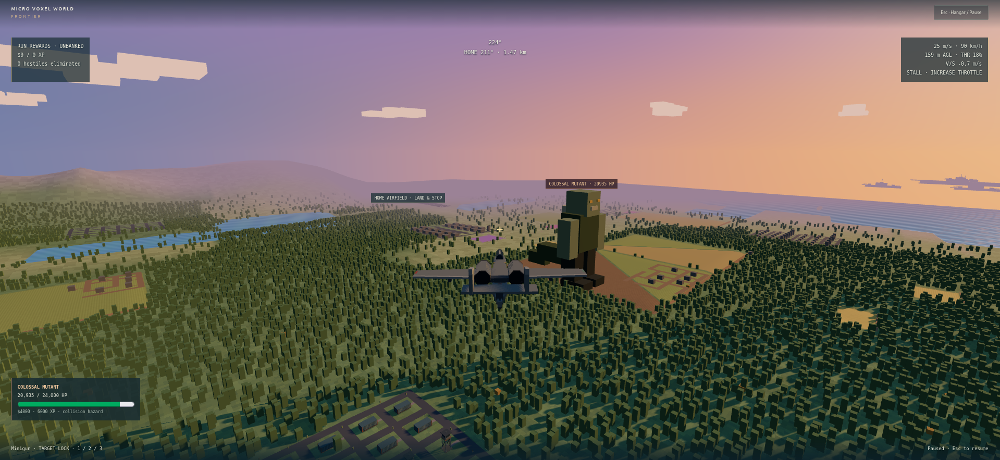

# Micro Voxel World: Frontier

**Take off. Find the fight. Make it home.**

Frontier is an arcade aircraft combat game set in a huge, procedurally generated world. Fly low across connected fields, dirt roads, forests, rivers and mountain ranges. Find roaming zombie hordes and towering mutant bosses and giant siege spiders, choose your attack, then bring your aircraft home to bank the rewards.

<p align="center">
  
</p>

## The sortie

A new pilot starts on the home runway with the Tier 1 Kestrel single-prop scout. Take off and head for a horde, explore a new region, or follow the hangar’s navigation marker toward **Carrier Resolute** and the sparse battleship groups in the ocean. Airfields and carrier decks both support the same landing, reward banking, shopping and takeoff loop.

Hordes are your targets. **Mutant Brutes** and **Colossal Mutants** tower over the terrain and carry large health pools. Giant Siege Spiders stand on eight jointed legs, with 12,000 HP and a $2,200 / 3,200 XP base reward. Giants roam slowly, turn toward nearby aircraft and wind up a close-range strike for one second. Climb or fly clear to evade them; their bodies are also solid collision hazards. Choose your weapon, line up a pass and keep clear of the ground.

Kills earn money and XP. A crash pays the run’s earnings; a safe landing and full stop pays a **100% bonus** on both money and XP. A successful landing opens the hangar, where you can train a pilot skill, buy and equip gear, or launch the next sortie. A carrier you land on becomes your recovery base for the rest of the session; reloading starts you back at home.

## A world worth exploring

The seeded landscape combines plains, forests, connected triangular and rectangular crop parcels, small flower fields, rural dirt tracks, towns, rivers, lakes, ocean and larger mountain ranges. Roads appear ahead of the aircraft as you travel. Sparse naval groups put carriers and battleships out on the water.

The pilot’s skill tree has three branches—Flight, Gunnery and Operations—with 18 skills and three ranks per skill. The equipment shop offers 18 unlocks for engine, weapon, airframe and utility slots. Skill points come from banked XP; cash purchases and loadout changes require a safe landing.

Boss rewards before bonuses:

- **Brute:** 24 m tall, 3,500 HP, $600 and 900 XP.
- **Colossus:** 125 m tall, 24,000 HP, $4,000 and 6,000 XP.

## Controls and landing

- **E / Q:** increase / reduce throttle. Hold Q to idle and brake on a runway or carrier deck.
- **W / S:** push / pull around the aircraft’s wing axis. Bank first, then pull to tighten the turn. **A / D:** roll.
- **Space:** fire. **1 / 2 / 3 / 4:** minigun, autocannon, explosive shell, homing missile. **C:** toggle camera orbit. **V:** cockpit / chase view.
- **M:** open the paused top-down world map. Pan with WASD or arrows, zoom with +/− or the buttons. M or Esc closes it.
- **Esc:** pause and open the hangar.

To take off, hold E to full power, accelerate to 32–35 m/s, then hold S to rotate. Release S about one second after liftoff and use short inputs to adjust the climb. Direct mode is the default: auto-level is off and aerodynamic trim is fixed. Enable Assisted mode in Settings for automatic leveling and airspeed trim. Holding full elevator commands an increasingly steep maneuver.

To land, line up with the strip, level the wings and touch down below 48 m/s while descending less than 4 m/s. Keep the whole aircraft inside the marked strip, then hold Q until the aircraft stops for one second. The destination selector changes your bearing and marker; it does not teleport the aircraft.

## Run Frontier

Use Node.js 26 and npm. If you use nvm, run `nvm use` in this folder
(the checked-in `.nvmrc` selects Node 26):

```sh
npm ci
npm run dev
```

Open [http://localhost:5173/](http://localhost:5173/) to play. Sound starts muted. Pilot progression and world changes save in your browser; reloading starts a new sortie at home.

## Voxel workshop

Open [the voxel workshop](http://localhost:5173/tools/voxel-editor/) directly, or
use the hangar’s **Enable developer tools** option. Inspect and edit voxel sources,
import/export JSON, and export optimized GLB meshes. Workshop edits are held only
for the session; export source JSON to keep them.

See the [workshop and development guide](docs/development.md) for editing controls,
asset references, commands and repository conventions.

## Development

- `npm run build` — typecheck and build Frontier and the workshop.
- `npm run preview` — serve the production build locally.
- `npm run check` — lint, unit tests, asset validation, build and browser checks.
- `npm run combat:benchmark` — run the retained headless crowd/fire benchmark.

Install the test browser once with `npx playwright install chromium`. Run browser
checks against a completed production build.

Historical prototype/lab instructions are kept in [development history](docs/development-history.md).
Benchmark-only legacy code is documented in [tools/benchmarks/legacy](tools/benchmarks/legacy/README.md).

Flight now trades speed for altitude: use a dive and power to build energy before
a loop, and ease off the elevator when the STALL warning appears. Stalling depends on angle of attack, rather than a fixed speed threshold. Tight banks
raise the stall speed. The cockpit loads only in first person. Combat effects
also controls turn rumble, wing condensation and directional sun glare. Detailed
trees extend to 420 m and morph into distant silhouettes through 700 m.

Elevator pull follows the banked aircraft, including sideways at knife-edge and
downward while inverted. Base thrust is 30 kN (2.5× the earlier 12 kN tuning).

Cloud banks now occupy seeded world positions and stream around the aircraft with
soft translucent edges. Rivers have animated currents and ripples; coastlines have
wet sand and breaking white foam. Pausing or disabling Combat effects freezes
water animation.

Homing missiles require one continuous second with the target inside the forward
18° lock cone (up to 480 m). Press Space after locking; missiles loft toward moving
targets and deal 6,000 direct damage plus a blast. Each launcher reloads for three
seconds. Losing the target or switching weapons resets acquisition.

The hangar places controls beside the aircraft and automatically orbits the runway
showcase. Five aircraft cards let you preview locked planes and select owned aircraft. Reduced
motion keeps the showcase camera still. The base includes fortified walls, watch
towers, hangars, barracks, tents, supplies and armored guards with solid collision.
After a crash the camera orbits the wreck as two rescue helicopters approach and
land; **Skip rescue** returns immediately. Rescue flight is cosmetic.

At 90% throttle the rear exhaust becomes an afterburner flame; below that it shows
a faint gas plume. Fast flight adds peripheral wind streaks. These obey Combat
effects, and wind animation respects reduced motion. Clouds now extend farther
into the distance with brighter sunlit tops and shaded, noise-shaped billows.

The procedural world has no small finite overview. The map can pan and zoom over
the full playable coordinate range using a cached 48×48 top-down terrain grid,
without loading another set of world chunks. It marks bases and nearby known
hostiles; distant encounters are not generated merely by opening the map.

## Build your aircraft collection

Each sortie is a run: take off, hunt, return and stop to collect double credits and
XP, read your debrief, train skills or buy equipment, then launch again. Crashes
keep base earnings and also produce a debrief. The hangar remembers your last run’s
aircraft, kills, flight time, earnings and landing bonus, and counts completed runs.

| Tier | Aircraft | Configuration | Unlock credits | Lifetime XP |
| --- | --- | --- | ---: | ---: |
| 1 | Kestrel S-1 | High-wing single center prop | Free | 0 |
| 2 | Mule T-2 | Larger twin wing props | 600 | 600 |
| 3 | Comet J-3 | Early swept-wing jet | 2,500 | 2,500 |
| 4 | Frontier A-4 | Original modern attack jet | 8,000 | 8,000 |
| 5 | Spectre X-5 | Advanced delta/canard twin-engine fighter | 24,000 | 24,000 |

Unlock the preceding aircraft first. XP is a lifetime requirement, not spent on
aircraft; credits pay the listed purchase price. Unlocks are permanent and aircraft
switching is free at a base. Click any aircraft card to inspect its detailed voxel
model and requirements. Locked previews cannot be flown. Each tier changes thrust,
speed, handling and weapon damage; purchased upgrades and equipment apply across
the collection. All four existing weapons remain usable from Tier 1.

Four original 0.1 m voxel sources add cockpit glazing and frames, access panels,
control surfaces, lights, landing gear, vents, weapon pods and tier-specific shapes.
Props rotate using cells from the editable model. The original Tier 4 model stays
unchanged. Only the selected or previewed aircraft owns live render resources.

Pilot v3 migrates v1/v2 credits, XP, upgrades, skills and equipment while preserving
the original records. Both new and migrated pilots begin the aircraft unlock chain
at Tier 1; earlier balances remain available to meet the new unlock requirements.
Aircraft ownership, selection and the last completed run persist across reloads.
